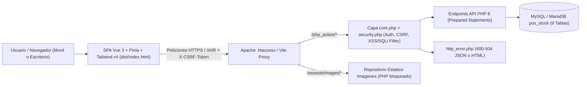
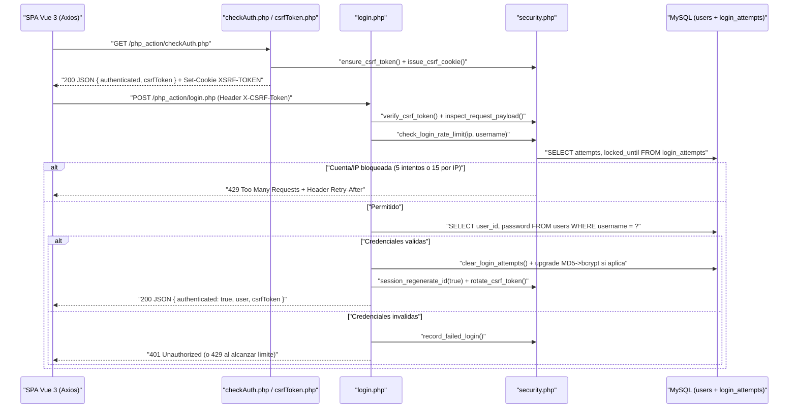
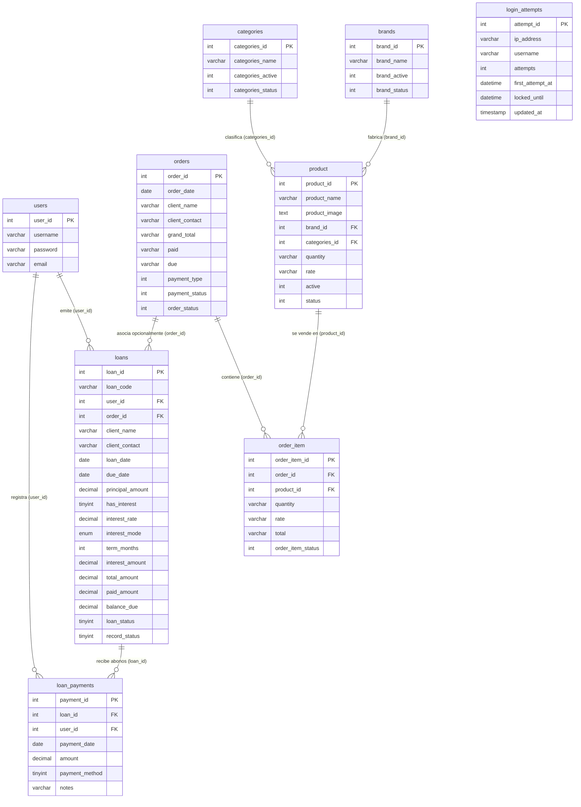

# PDR — Preliminary Design Review & Auditoría Técnica

**Proyecto:** Stock Bartolo — Sistema de Gestión de Inventario, Ventas (POS) y Préstamos  
**Versión:** `2.0.0` (SPA Vue 3 + Pinia + API PHP 8 Endurecida)  
**Fecha:** 10 de noviembre de 2026

---

## 1. Resumen Ejecutivo

Este documento presenta el diseño arquitectónico, análisis funcional de componentes, modelo de seguridad y resultados de auditoría de **Stock Bartolo** tras su transformación integral desde una aplicación PHP multipágina (MPA con jQuery/Bootstrap) hacia una **Single-Page Application (SPA)** moderna, responsiva y segura.

### Objetivos Cubiertos

| ID | Objetivo | Estado | Evidencia Principal |
| :--- | :--- | :--- | :--- |
| **OBJ-1** | Rediseño responsivo del layout principal y vistas | Completado | [MainLayout.vue](src/layouts/MainLayout.vue), [ui.js](src/stores/ui.js), todas las vistas `src/views/*.vue` |
| **OBJ-2** | Nuevo módulo de préstamos emitidos por usuario logueado con opción de interés | Completado | [LoansView.vue](src/views/LoansView.vue), [loans.js](src/stores/loans.js), `php_action/*Loan*.php` |
| **OBJ-3** | Páginas dedicadas de error HTTP (`500`, `404`, `403`, `400`, `501`, `503` y afines) | Completado | [ErrorView.vue](src/views/ErrorView.vue), [httpErrors.js](src/constants/httpErrors.js), [http_error.php](php_action/http_error.php), [.htaccess](.htaccess) |
| **OBJ-4** | Migración a SPA con `npm`, Vue 3, Pinia, Vue Router, Axios y Tailwind CSS | Completado | [package.json](package.json), [vite.config.js](vite.config.js), [router/index.js](src/router/index.js) |
| **OBJ-5** | Eliminación de vistas `.php` obsoletas | Completado | Removidos 12 archivos `.php` de vistas, includes y modales en raíz, `includes/` y `modal/` |
| **OBJ-6** | Seguridad en formularios y API (XSS, CSRF, rate limit, código malicioso, SQLi) | Completado | [security.php](php_action/security.php), [core.php](php_action/core.php), [client.js](src/api/client.js), [security.js](src/utils/security.js) |
| **OBJ-7** | Análisis integral del sistema, corrección de hallazgos y documentación (`README.md` y `PDR.md`) | Completado | [README.md](README.md), [PDR.md](PDR.md) |

---

## 2. Arquitectura del Sistema

### 2.1 Diagrama de Arquitectura General

### 2.2 Flujo de Autenticación, CSRF y Control de Rate Limit

---

## 3. Modelo de Datos y Reglas de Negocio

### 3.1 Diagrama Entidad-Relación (`pos_stock`)

### 3.2 Fórmulas Financieras y Reglas del Módulo de Préstamos

Implementado de forma simétrica en el frontend (`calculateLoanPreview()` en [src/stores/loans.js](src/stores/loans.js)) y validado autoritativamente en el servidor ([createLoan.php](php_action/createLoan.php), [editLoan.php](php_action/editLoan.php), [addLoanPayment.php](php_action/addLoanPayment.php)):

1. **Sin interés (`has_interest = 0`)**:
   - `interest_rate = 0.00`
   - `interest_amount = 0.00`
   - `total_amount = principal_amount`
2. **Con interés (`has_interest = 1`, tasa entre `0.01%` y `1000%`, plazo entre `1` y `360` meses)**:
   - Modalidad `flat` (porcentaje único sobre capital):
     $$\text{interest\_amount} = \text{round}\left(P \times \frac{r}{100},\ 2\right)$$
   - Modalidad `monthly` (interés mensual simple):
     $$\text{interest\_amount} = \text{round}\left(P \times \frac{r}{100} \times m,\ 2\right)$$
   - Total del préstamo y cuota estimada:
     $$\text{total\_amount} = \text{round}(P + \text{interest\_amount},\ 2), \qquad \text{cuota} = \text{round}\left(\frac{\text{total\_amount}}{m},\ 2\right)$$
3. **Ciclo de vida de estado (`loan_status`)**:
   - `1` (**Activo**): `paid_amount = 0` y fecha de vencimiento vigente o sin definir.
   - `2` (**En abonos / Parcial**): `paid_amount > 0` y `balance_due > 0`.
   - `3` (**Pagado / Liquidado**): `balance_due <= 0` tras abono inicial o subsecuente.
   - `4` (**Vencido**, calculado dinámicamente en lectura): `loan_status != 3`, `balance_due > 0` y `due_date < CURDATE()`.
4. **Integridad transaccional en abonos y ediciones**:
   - `addLoanPayment.php` bloquea la fila con `SELECT ... FOR UPDATE`, impide abonos mayores al `balance_due` actual y actualiza `paid_amount`, `balance_due` y `loan_status` dentro de una transacción.
   - `editLoan.php` verifica que el nuevo `total_amount` nunca sea inferior a lo ya abonado (`paid_amount`).
   - Tanto `createLoan.php` como `editLoan.php` validan que cualquier `order_id` opcional corresponda a una orden activa existente.

---

## 4. Análisis de Arquitectura Frontend

### 4.1 Stores Pinia (`src/stores/`)

| Store | Archivo | Responsabilidad |
| :--- | :--- | :--- |
| `useAuthStore` | [auth.js](src/stores/auth.js) | Estado de sesión (`user`, `authenticated`, `checked`), login/logout, sincronización de `csrfToken`, actualización de usuario/contraseña |
| `useUiStore` | [ui.js](src/stores/ui.js) | Estado responsivo (`sidebarCollapsed`, `mobileMenuOpen`) y cola de notificaciones toast (`success`, `error`, `warning`, `info`) |
| `useErrorStore` | [error.js](src/stores/error.js) | Captura contextual de errores HTTP (`code`, `customMessage`, `path`, `timestamp`) alimentada por Axios y Vue Router |
| `useDashboardStore` | [dashboard.js](src/stores/dashboard.js) | KPIs consolidados de inventario, órdenes recientes, alertas de stock bajo y resumen de préstamos |
| `useBrandsStore` | [brands.js](src/stores/brands.js) | Listado y mutaciones CRUD de fabricantes |
| `useCategoriesStore` | [categories.js](src/stores/categories.js) | Listado y mutaciones CRUD de categorías |
| `useProductsStore` | [products.js](src/stores/products.js) | Catálogo, carga `multipart/form-data` para creación y cambio de imagen de producto |
| `useOrdersStore` | [orders.js](src/stores/orders.js) | Órdenes, catálogo disponible, edición de pagos e impresión de comprobantes |
| `useLoansStore` | [loans.js](src/stores/loans.js) | Cartera de préstamos, resumen financiero, historial de abonos y función `calculateLoanPreview()` |
| `useReportsStore` | [reports.js](src/stores/reports.js) | Consultas de reporte por rango de fechas para órdenes y préstamos |

### 4.2 Vistas, Componentes y Diseño Responsivo

- **Shell de Navegación ([MainLayout.vue](src/layouts/MainLayout.vue))**:
  - Escritorio (`>= lg` / `1024px`): barra lateral fija colapsable (`lg:w-64` / `lg:w-20`).
  - Móvil/Tableta (`< 1024px`): drawer fuera de lienzo con transición y clase de accesibilidad `invisible lg:visible` cuando está cerrado para evitar foco/interacción fantasma fuera de pantalla; cierre automático en navegación desde `router.beforeEach`.
- **Componentes Reutilizables**:
  - [BaseModal.vue](src/components/common/BaseModal.vue): modal accesible con tecla `Escape`, tamaños configurables (`sm`, `md`, `lg`, `xl`) y ranura de pie de página.
  - [ConfirmModal.vue](src/components/common/ConfirmModal.vue): diálogo de confirmación para operaciones destructivas.
  - [StatusBadge.vue](src/components/common/StatusBadge.vue) y [ToastContainer.vue](src/components/common/ToastContainer.vue).
  - Componentes especializados de préstamos: [LoanFormModal.vue](src/components/loans/LoanFormModal.vue), [LoanPaymentModal.vue](src/components/loans/LoanPaymentModal.vue) y [LoanDetailModal.vue](src/components/loans/LoanDetailModal.vue).
- **Vistas de Negocio**:
  - [LoginView.vue](src/views/LoginView.vue), [DashboardView.vue](src/views/DashboardView.vue), [BrandsView.vue](src/views/BrandsView.vue), [CategoriesView.vue](src/views/CategoriesView.vue), [ProductsView.vue](src/views/ProductsView.vue), [OrdersListView.vue](src/views/OrdersListView.vue), [OrderFormView.vue](src/views/OrderFormView.vue), [LoansView.vue](src/views/LoansView.vue), [ReportsView.vue](src/views/ReportsView.vue), [SettingsView.vue](src/views/SettingsView.vue), [ErrorView.vue](src/views/ErrorView.vue).

### 4.3 Manejo de Errores HTTP

El catálogo [httpErrors.js](src/constants/httpErrors.js) mapea los códigos **`400, 401, 403, 404, 405, 408, 422, 429, 500, 501, 502, 503, 504`**:
- El interceptor de respuesta en [client.js](src/api/client.js) intercepta timeouts (`ECONNABORTED` -> `408`), fallos de red (`!error.response` -> `503`), sesiones caducadas (`401` -> redirección a `/login?redirect=...`) y códigos críticos (`403, 429, 500, 501, 502, 503, 504`) redirigiendo a `error-page`, salvo cuando se especifica `{ skipErrorRedirect: true }` en formularios inline (por ejemplo login o modales con validación propia).
- El servidor Apache ([.htaccess](.htaccess)) delega `ErrorDocument` en `/php_action/error.php?code=...` para errores HTTP directos y en `/dist/index.html` para rutas SPA no encontradas.

---

## 5. Arquitectura de Seguridad y Matriz de Mitigación

| Amenaza | Vector de Ataque | Defensa Frontend | Defensa Backend & Servidor | Código HTTP / Acción |
| :--- | :--- | :--- | :--- | :--- |
| **XSS (Stored / Reflected / DOM)** | Etiquetas HTML/JS en formularios, búsqueda o comprobante de impresión (`printInvoice`) | Renderizado declarativo Vue `{{ }}`; función `escapeHtml()` aplicada a todo campo impreso en [OrdersListView.vue](src/views/OrdersListView.vue) y [LoanDetailModal.vue](src/components/loans/LoanDetailModal.vue); `findUnsafeField()` antes de enviar | `sanitize_clean_text()` con `strip_tags()`, remoción de caracteres de control y `Content-Security-Policy` estricto (`default-src 'self'` en SPA; `default-src 'none'` en JSON) | Rechaza con **400 Bad Request** si detecta carga maliciosa |
| **CSRF** | Peticiones `POST/PUT/DELETE` falsificadas desde sitios de terceros | Precarga automática (`ensureCsrfToken()`) y cabecera `X-CSRF-Token` en toda petición mutante; resincronización cuando rota | Token de 256 bits (`random_bytes(32)`), cookie `XSRF-TOKEN` (`SameSite=Lax`), verificación `hash_equals()` en `verify_csrf_token()`, rotación al autenticar o cambiar clave | **403 Forbidden** (`details.reason = 'csrf_invalid'`) |
| **Fuerza Bruta / Credential Stuffing** | Múltiples intentos fallidos contra `/php_action/login.php` | Indicador claro de error y mensajes informativos sin redirección abrupta | Tabla `login_attempts`: bloqueo de 15 min tras **5 intentos** por `(ip, username)` o **15 intentos** desde la misma IP en ventana de 900s; conteo limpio tras éxito | **429 Too Many Requests** + cabecera `Retry-After` |
| **Inserción de Código Malicioso** | Cargas `<script>`, `<?php`, `<iframe>`, `<svg onload=...>`, `javascript:`, `vbscript:`, `data:text/html`, event handlers inline, `\0` | `hasSuspiciousInput()` y `findUnsafeField()` en los 8 formularios principales del cliente | `inspect_request_payload()` inspecciona recursivamente `$_GET`, `$_POST` y JSON decodificado (permitiendo símbolos complejos solo en contraseñas, salvo bytes nulos y límite de longitud) | **400 Bad Request** indicando campo y regla disparada |
| **SQL Injection** | Manipulación de parámetros `GET`/`POST`/JSON con `' OR 1=1`, `UNION SELECT`, `INTO OUTFILE`, `SLEEP()` | Validación de tipos/longitudes y detección temprana en `findUnsafeField()` | 100% de consultas parametrizadas (`$connect->prepare()` + `bind_param()`), validación estricta de fechas (`validate_iso_date()`) y filtro regex para `UNION SELECT` / `SLEEP` / `OUTFILE` | **400 Bad Request** o parametrización segura |
| **Subida de Archivos Maliciosos** | Subida de scripts `.php` disfrazados como imagen o archivos gigantes | Pre-validación de tipo/tamaño y liberación segura de `ObjectURL` en [ProductsView.vue](src/views/ProductsView.vue) | `process_uploaded_product_image()`: límite 5 MB, whitelist de extensiones y MIME reales vía `finfo`, verificación dimensional `getimagesize()`, nombre CSPRNG `bin2hex(random_bytes(16))` y `assests/images/.htaccess` bloqueando ejecución PHP/CGI e índices | **400 Bad Request** (y ejecución bloqueada en Apache) |
| **Secuestro de Sesión / Exposición de Datos** | Acceso a endpoints sin sesión, robo de cookies JS, exposición de stack traces | Interceptor `401` limpia estado Pinia y redirige a `/login` | `display_errors=0`, cookies de sesión `HttpOnly` + `SameSite=Lax` + `Secure` (en HTTPS), `use_strict_mode=1`, timeout de inactividad (`7200s`), `Cache-Control: no-store` en API y bloqueo de `.sql`/dotfiles en `.htaccess` | **401 Unauthorized** en expiración/ausencia de sesión |

---

## 6. Auditoría del Sistema y Hallazgos Resueltos

Durante la revisión línea por línea de todos los módulos backend y frontend se detectaron y corrigieron los siguientes defectos:

1. **Error crítico en reportes por tipos PHP 8 (`php_action/getOrderReport.php`)**:
   - *Hallazgo:* En código legado, se sumaban/formateaban valores sin inicializar correctamente o causando potencial `TypeError` en aritmética con `string` de columnas `varchar` en `orders`.
   - *Solución:* Conversión explícita `(float)` antes de acumular, agregación paralela de préstamos en el mismo rango y ordenamiento seguro con consultas preparadas.
2. **Orden de validación Auth vs CSRF (`php_action/core.php`)**:
   - *Hallazgo:* Si expiraba la cookie de sesión en una petición mutante, validar CSRF antes que la sesión producía `403` en vez de `401`, impidiendo la redirección fluida a `/login`.
   - *Solución:* [core.php](php_action/core.php) verifica `$_SESSION['userId']` (`401`) antes de `verify_csrf_token()` (`403`), excepto cuando `SKIP_AUTH_CHECK` está activo (`login.php` y `logout.php`).
3. **Borrado prematuro de ítems ante ID inexistente (`php_action/editOrder.php`)**:
   - *Hallazgo:* No se comprobaba previamente si la orden existía activa antes de procesar ítems y restaurar inventario.
   - *Solución:* Se añadió consulta transaccional `SELECT order_id FROM orders WHERE order_id = ? AND order_status = 1 FOR UPDATE`, devolviendo `404 Not Found` si no existe.
4. **Restauración de stock al anular órdenes (`php_action/removeOrder.php`)**:
   - *Hallazgo:* La anulación solo cambiaba `order_status = 2` sin reintegrar las cantidades al inventario ni bloquear concurrencia.
   - *Solución:* Transacción completa con `FOR UPDATE` y reposición de `product.quantity` por cada `order_item` activo.
5. **Validación de `order_id` opcional en préstamos (`php_action/createLoan.php`, `editLoan.php`)**:
   - *Hallazgo:* Podía referenciarse un `order_id` inexistente o eliminado.
   - *Solución:* Validación explícita contra `orders WHERE order_id = ? AND order_status = 1` devolviendo `400` si no existe.
6. **XSS en comprobante de impresión (`src/views/OrdersListView.vue`)**:
   - *Hallazgo:* `printInvoice()` interpolaba `client_name`, `client_contact` y `product_name` directo en `win.document.write()`.
   - *Solución:* Todas las propiedades dinámicas se envuelven con `escapeHtml()` ([src/views/OrdersListView.vue](src/views/OrdersListView.vue#L449-L489)).
7. **Fuga de memoria por `ObjectURL` (`src/views/ProductsView.vue`)**:
   - *Hallazgo:* Previsualizaciones locales creadas con `URL.createObjectURL()` no se revocaban al reemplazar imagen o desmontar el componente.
   - *Solución:* Se implementó `revokePreviewUrl()` invocada al cambiar archivo, cerrar modal y en `onUnmounted()`.
8. **Sincronización reactiva de usuario en configuración (`src/views/SettingsView.vue`)**:
   - *Hallazgo:* Si el usuario recargaba directo en `/settings`, el campo `username` podía inicializar vacío antes de resolver `checkAuth()`.
   - *Solución:* `watch(() => auth.user?.username, ...)` con `{ immediate: true }`.
9. **Accesibilidad del drawer móvil y favicon (`src/layouts/MainLayout.vue`, `index.html`)**:
   - *Hallazgo:* En viewports móviles `< 1024px`, `<aside>` cerrado solo usaba `-translate-x-full` sin `invisible`, dejando enlaces detectables fuera de pantalla; además el navegador emitía un `404` por `/favicon.ico`.
   - *Solución:* Añadido `invisible lg:visible` al `<aside>` cuando `!ui.mobileMenuOpen` en [MainLayout.vue](src/layouts/MainLayout.vue#L13-L20) y `<link rel="icon" type="image/svg+xml" ...>` en [index.html](index.html#L6-L10).
10. **Soporte transparente de contraseñas legadas (`php_action/login.php`, `changePassword.php`)**:
    - *Hallazgo:* La base histórica almacenaba contraseñas en `md5`.
    - *Solución:* Verificación dual segura y actualización automática silenciosa a `password_hash(..., PASSWORD_DEFAULT)` en el primer login exitoso.

### 6.1 Inventario de Archivos `.php` Obsoletos Eliminados

Se eliminaron del repositorio las 12 vistas, plantillas y modales PHP reemplazados por la SPA (y el antiguo `php_action/error_log`):
- `index.php`, `dashboard.php`, `brand.php`, `categories.php`, `product.php`, `orders.php`, `report.php`, `setting.php`, `logout.php`
- `includes/header.php`, `includes/footer.php`
- `modal/brandModal.php`, `modal/categoriesModal.php`, `modal/productModal.php`
- `php_action/error_log`

> **Nota de auditoría sobre activos legados:** Las carpetas `custom/` y librerías de terceros en `assests/` (`bootstrap`, `jquery`, `jquery-ui`, `font-awesome`, `plugins`) no son utilizadas ni importadas por la SPA ni por la compilación Vite; se conservaron únicamente para no alterar `assests/images/` (donde residen las fotografías de productos de inventario y `photo_default.png`) y pueden depurarse en un paso futuro si se migran las imágenes fuera de `assests/`.

---

## 7. Resumen de Verificación y Pruebas

Todas las pruebas fueron ejecutadas directamente contra el entorno real (`PHP 8.3`, `MariaDB/MySQL`, `Vite 8` y `Chromium/Playwright`), limpiando posteriormente todos los datos temporales de prueba:

| Verificación | Alcance | Resultado |
| :--- | :--- | :--- |
| **Sintaxis PHP (`php -l`)** | Los 45 archivos en `php_action/*.php` | **45/45 aprobados (0 errores)** |
| **Migración de Esquema** | `ensure_app_schema($connect)` en `pos_stock` | **9/9 tablas verificadas** (`brands`, `categories`, `loan_payments`, `loans`, `login_attempts`, `order_item`, `orders`, `product`, `users`) |
| **Compilación SPA (`npm run build`)** | Bundle Vite + Vue 3 + Tailwind CSS v4 | **Exitoso** (`dist/index.html`, CSS y JS generados sin advertencias) |
| **Suite Automatizada API & Seguridad** | Auth `401`, cabeceras CSP/X-Frame, CSRF `403`, XSS `<script>` `400`, SQLi `UNION SELECT` `400`, brute-force `429` + `Retry-After`, upload falso `400`, CRUD Brands/Categories/Products (PNG real), Órdenes (descuento + reposición stock), Préstamos (sin interés y con interés mensual + abono liquidatorio), Reportes, HTTP Errors (`400..504` JSON/HTML), Logout (`405`/`200`) | **Aprobado al 100% (`{"ok":true}`)** |
| **Auditoría Visual y Funcional en Navegador (Playwright)** | Login `admin`, `/dashboard`, `/loans` + modal e interruptor de interés en vivo, `/products` (carga real de imagen), `/orders`, `/brands`, `/categories`, `/reports`, `/settings`, páginas `/error/500`, `/error/403`, `/error/400`, `/error/501`, `/error/503`, catch-all `404` (`/ruta-inexistente`), viewport escritorio (`1280x800`) y móvil (`375x812`) con apertura de menú drawer | **0 errores de consola**, **0 errores de red** y **sin desbordamiento horizontal (`scrollWidth 360 <= innerWidth 375`)** |

