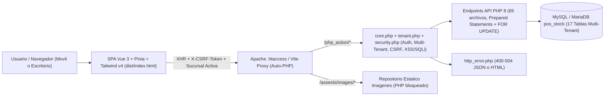
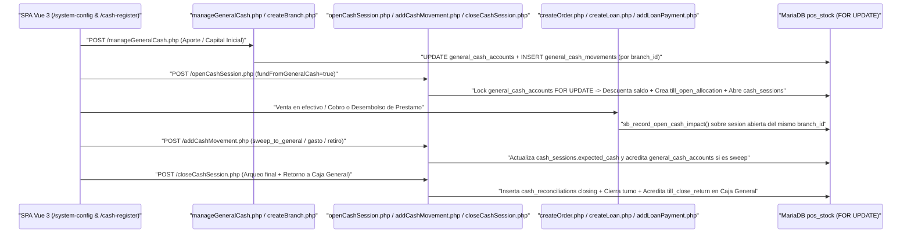
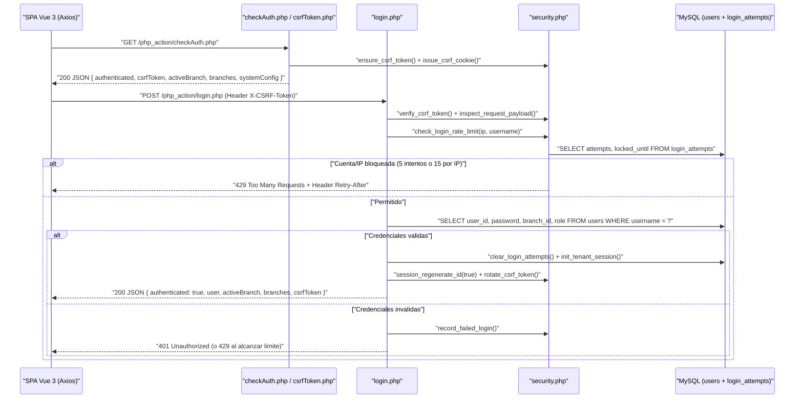
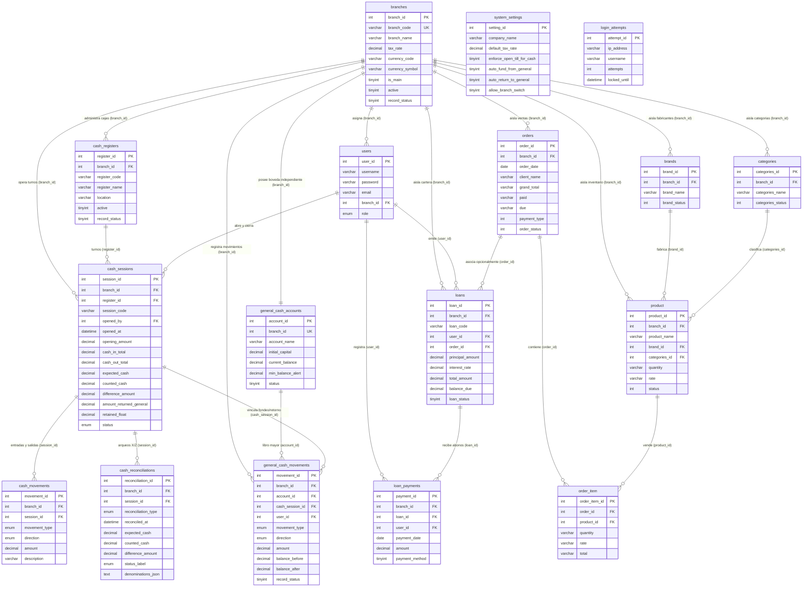

# PDR — Preliminary Design Review & Auditoría Técnica

**Proyecto:** Stock Bartolo — Sistema Multi-Sucursal de Inventario, Ventas (POS), Caja y Préstamos  
**Versión:** `2.2.0` (SPA Vue 3 + Pinia + Multi-Tenant + Caja General & Control de Caja)  
**Fecha:** 10 de noviembre de 2026

---

## 1. Resumen Ejecutivo

Este documento presenta la arquitectura técnica, el modelo relacional multi-sucursal (*multi-tenant*), los flujos financieros entre **Caja General** y **Caja Registradora**, el análisis de componentes, la matriz de seguridad y el registro de auditoría y pruebas de **Stock Bartolo**.

### Objetivos Cubiertos

| ID | Objetivo | Estado | Evidencia Principal |
| :--- | :--- | :--- | :--- |
| **OBJ-1** | Rediseño responsivo del layout principal y vistas | Completado | [MainLayout.vue](src/layouts/MainLayout.vue), [ui.js](src/stores/ui.js), todas las vistas `src/views/*.vue` |
| **OBJ-2** | Nuevo módulo de préstamos emitidos por usuario logueado con opción de interés | Completado | [LoansView.vue](src/views/LoansView.vue), [loans.js](src/stores/loans.js), `php_action/*Loan*.php` |
| **OBJ-3** | Páginas dedicadas de error HTTP (`500`, `404`, `403`, `400`, `501`, `503` y afines) | Completado | [ErrorView.vue](src/views/ErrorView.vue), [httpErrors.js](src/constants/httpErrors.js), [http_error.php](php_action/http_error.php), [.htaccess](.htaccess) |
| **OBJ-4** | Migración a SPA con `npm`, Vue 3, Pinia, Vue Router, Axios y Tailwind CSS | Completado | [package.json](package.json), [vite.config.js](vite.config.js), [router/index.js](src/router/index.js) |
| **OBJ-5** | Eliminación de vistas `.php` obsoletas | Completado | Removidos 12 archivos `.php` de vistas, includes y modales en raíz, `includes/` y `modal/` |
| **OBJ-6** | Seguridad en formularios y API (XSS, CSRF, rate limit, código malicioso, SQLi) | Completado | [security.php](php_action/security.php), [core.php](php_action/core.php), [client.js](src/api/client.js), [security.js](src/utils/security.js) |
| **OBJ-7** | Resolución de `502 Bad Gateway` en desarrollo y documentación técnica (`README.md`, `PDR.md`) | Completado | [vite.config.js](vite.config.js), [.htaccess](.htaccess), [README.md](README.md), [PDR.md](PDR.md) |
| **OBJ-8** | Módulo **Configuración del Sistema** y **Caja General** multi-sucursal con CRUD completo | Completado | [SystemConfigView.vue](src/views/SystemConfigView.vue), [systemConfig.js](src/stores/systemConfig.js), `php_action/fetchSystemConfig.php`, `saveSystemConfig.php`, `fetchGeneralCash.php`, `manageGeneralCash.php` |
| **OBJ-9** | Arquitectura **Multi-Sucursal (Multi-Tenant)** con aislamiento estricto por `branch_id` y CRUD | Completado | [tenant.php](php_action/tenant.php), `php_action/*Branch*.php`, `ensure_schema.php`, selector global en [MainLayout.vue](src/layouts/MainLayout.vue) |
| **OBJ-10** | Módulo **Caja / Control de Caja** (Cajas CRUD, Apertura, Movimientos, Arqueo, Cierre Corte Z e integración POS/Préstamos) | Completado | [CashRegisterView.vue](src/views/CashRegisterView.vue), [cashRegister.js](src/stores/cashRegister.js), `src/components/cash/*`, `php_action/*Cash*.php` |

---

## 2. Arquitectura del Sistema

### 2.1 Diagrama de Arquitectura General

### 2.2 Flujo de Capital Operativo: Caja General ↔ Caja Registradora (Por Sucursal)

### 2.3 Flujo de Autenticación, CSRF y Control de Rate Limit

---

## 3. Modelo de Datos Multi-Tenant y Reglas Financieras

### 3.1 Diagrama Entidad-Relación Completo (`pos_stock` — `17` Tablas)

### 3.2 Reglas de Negocio Multi-Sucursal, Caja General y Caja

1. **Aislamiento de Tenant (`tenant.php`)**:
   - Toda consulta de lectura o escritura operativa exige coincidencia `branch_id = sb_current_branch_id()`.
   - Las cuentas con `role = 'superadmin'` (como `admin`) pueden alternar libremente entre sucursales activas vía `POST /php_action/switchBranch.php`; los usuarios con `role != 'superadmin'` quedan fijados a su `branch_id` asignado (`403 Forbidden` ante intentos de cambio cruzado).
   - Al crear una sucursal en `createBranch.php`, una misma transacción SQL crea su `general_cash_accounts` (con `initial_capital` opcional en `general_cash_movements`) y su caja registradora base `CAJA-01`.
2. **Integridad de Caja General (`manageGeneralCash.php`)**:
   - Toda operación (`deposit`, `withdrawal`, `initial_capital`, `adjustment_in`, `adjustment_out`) bloquea la fila de `general_cash_accounts` con `SELECT ... FOR UPDATE`, impide retiros/ajustes que excedan el saldo disponible y recalcula la cadena cronológica al anular movimientos manuales (protegiendo de anulación directa los movimientos vinculados automáticamente a aperturas/cierres de caja).
3. **Ciclo de Vida de Caja (`openCashSession.php` → `addCashMovement.php` → `reconcileCashSession.php` → `closeCashSession.php`)**:
   - Impide doble apertura simultánea de la misma `register_id`.
   - `sb_assert_cash_operation_allowed()` en órdenes/préstamos en efectivo bloquea la operación (`400 Bad Request`) cuando la política `enforce_open_till_for_cash = 1` está habilitada y la sucursal activa no tiene turno abierto.
   - `sb_record_open_cash_impact()` suma/resta automáticamente ventas (`sale_cash`, `order_payment_cash`) y préstamos (`loan_disbursement`, `loan_payment_cash`) sobre el turno abierto de la sucursal.
   - El cálculo del efectivo esperado en gaveta sigue exactamente:
     $$\text{expected\_cash} = \text{round}(\text{opening\_amount} + \text{cash\_in\_total} - \text{cash\_out\_total},\ 2)$$
   - Al cerrar (`Corte Z`), `amount_returned_general` se valida $\le \text{counted\_cash}$ y se retiene la diferencia ($\text{retained\_float} = \text{counted\_cash} - \text{amount\_returned\_general}$).
4. **Fórmulas del Módulo de Préstamos**:
   - Sin interés (`has_interest = 0`): `interest_amount = 0.00`, `total_amount = principal_amount`.
   - Modalidad `flat`: `round(P * r / 100, 2)`; modalidad `monthly`: `round(P * (r / 100) * m, 2)`.

---

## 4. Análisis de Arquitectura Frontend

### 4.1 Stores Pinia (`src/stores/`) — 12 Stores

| Store | Archivo | Responsabilidad |
| :--- | :--- | :--- |
| `useAuthStore` | [auth.js](src/stores/auth.js) | Sesión (`user`, `authenticated`, `csrfToken`), sucursal activa (`activeBranch`, `branches`), `systemConfig` global y `switchBranch()` |
| `useUiStore` | [ui.js](src/stores/ui.js) | Sidebar desktop, drawer móvil y notificaciones toast |
| `useErrorStore` | [error.js](src/stores/error.js) | Contexto de errores HTTP interceptados por Axios / Vue Router |
| `useDashboardStore` | [dashboard.js](src/stores/dashboard.js) | KPIs de la sucursal activa + tarjetas en vivo de `Caja General` y `Caja Registradora` |
| `useSystemConfigStore` | [systemConfig.js](src/stores/systemConfig.js) | Bóvedas de Caja General multi-sucursal, movimientos CRUD, sucursales CRUD y parámetros del sistema |
| `useCashRegisterStore` | [cashRegister.js](src/stores/cashRegister.js) | Terminales de caja, apertura, movimientos, arqueo (12 denominaciones), cierre Corte Z y detalle Corte X |
| `useBrandsStore` | [brands.js](src/stores/brands.js) | CRUD de fabricantes de la sucursal activa |
| `useCategoriesStore` | [categories.js](src/stores/categories.js) | CRUD de categorías de la sucursal activa |
| `useProductsStore` | [products.js](src/stores/products.js) | Catálogo y subidas seguras de imagen por sucursal |
| `useOrdersStore` | [orders.js](src/stores/orders.js) | Ventas, edición con reposición de stock, cobros e impresión |
| `useLoansStore` | [loans.js](src/stores/loans.js) | Cartera de préstamos, abonos y `calculateLoanPreview()` |
| `useReportsStore` | [reports.js](src/stores/reports.js) | Reportes por rango de fechas de la sucursal activa |

### 4.2 Vistas, Componentes y Layout Reactivo

- **Shell Multi-Sucursal ([MainLayout.vue](src/layouts/MainLayout.vue))**:
  - Selector desplegable de sucursal activa en cabecera superior con saldo rápido de `Caja General` por tenant.
  - Remonte reactivo de `<RouterView :key="route.fullPath + '::branch-' + activeBranchId" />` tras cada cambio de sucursal para evitar estado residual entre tenants.
  - Drawer móvil con clase `invisible lg:visible` al estar cerrado para evitar interacción fuera de pantalla.
- **Componentes Especializados (`16` componentes)**:
  - Comunes (`4`): `BaseModal`, `ConfirmModal`, `StatusBadge`, `ToastContainer`.
  - Configuración y Caja General (`3`): [BranchFormModal.vue](src/components/system/BranchFormModal.vue), [GeneralCashMovementModal.vue](src/components/system/GeneralCashMovementModal.vue), [GeneralCashConfigModal.vue](src/components/system/GeneralCashConfigModal.vue).
  - Control de Caja (`6`): [CashRegisterModal.vue](src/components/cash/CashRegisterModal.vue), [OpenCashModal.vue](src/components/cash/OpenCashModal.vue), [CashMovementModal.vue](src/components/cash/CashMovementModal.vue), [ReconcileCashModal.vue](src/components/cash/ReconcileCashModal.vue), [CloseCashModal.vue](src/components/cash/CloseCashModal.vue), [CashSessionDetailModal.vue](src/components/cash/CashSessionDetailModal.vue).
  - Préstamos (`3`): `LoanFormModal`, `LoanPaymentModal`, `LoanDetailModal`.

---

## 5. Arquitectura de Seguridad y Matriz de Mitigación

| Amenaza | Vector de Ataque | Defensa Frontend | Defensa Backend & Servidor | Código HTTP / Acción |
| :--- | :--- | :--- | :--- | :--- |
| **Aislamiento Multi-Tenant** | Acceso/edición/anulación de IDs pertenecientes a otra sucursal | Selector controlado en `useAuthStore`; recarga limpia al cambiar tenant | `sb_current_branch_id()` forzado en todos los `SELECT/UPDATE/DELETE` y verificación `role === 'superadmin'` en `switchBranch.php` | **404 Not Found** o **403 Forbidden** |
| **Condiciones de Carrera en Saldos** | Aperturas concurrentes, sobre-giros en Caja General o doble cobro en préstamos/ventas | Botones deshabilitados durante `saving` | Transacciones InnoDB con `SELECT ... FOR UPDATE` en `general_cash_accounts`, `cash_sessions`, `product` y `loans` | **400 Bad Request** o bloqueo serializado |
| **XSS (Stored / Reflected / DOM)** | Cargas `<script>`, ``, `<svg onload>` o impresión de tickets/Cortes X-Z | `{{ }}` Vue + `escapeHtml()` en `OrdersListView.vue`, `LoanDetailModal.vue` y `CashSessionDetailModal.vue` | `sanitize_clean_text()` (`strip_tags()`) + CSP estricto (`default-src 'self'` / `'none'`) | Rechaza con **400 Bad Request** |
| **CSRF** | Mutaciones `POST/PUT/DELETE` desde terceros | Cookie `XSRF-TOKEN` + cabecera `X-CSRF-Token` y reintento automático único | Token de 256 bits (`hash_equals()`), rotación en login/password | **403 Forbidden** |
| **Fuerza Bruta** | Múltiples intentos en `login.php` | Alertas inline sin redirección | Tabla `login_attempts`: bloqueo tras 5 intentos por cuenta/IP o 15 por IP | **429 Too Many Requests** + `Retry-After` |
| **SQL Injection & Código Malicioso** | Cargas `UNION SELECT`, `INTO OUTFILE`, `SLEEP()`, `<?php`, `javascript:` | `hasSuspiciousInput()` y `findUnsafeField()` | `100%` sentencias preparadas (`mysqli::prepare`) + `inspect_request_payload()` | **400 Bad Request** |
| **Subidas Maliciosas** | Scripts PHP disfrazados de imagen | Pre-validación de tipo/tamaño y `revokePreviewUrl()` | Límite 5 MB, `finfo`, `getimagesize()`, nombre CSPRNG y `assests/images/.htaccess` | **400 Bad Request** |

---

## 6. Auditoría del Sistema y Hallazgos Resueltos

1. **Error en reportes con columnas `varchar` en PHP 8 (`php_action/getOrderReport.php`)**: conversión explícita `(float)` y agregación paralela de préstamos.
2. **Orden de validación Auth vs CSRF (`php_action/core.php`)**: verificación de sesión (`401`) previa a CSRF (`403`).
3. **Integridad de stock en órdenes (`php_action/editOrder.php`, `removeOrder.php`)**: bloqueo `FOR UPDATE` previo y reposición exacta de inventario al editar o anular.
4. **Prevención de XSS en impresiones (`OrdersListView.vue`, `LoanDetailModal.vue`, `CashSessionDetailModal.vue`)**: sanitización completa con `escapeHtml()` en tickets, comprobantes de préstamo y Cortes X/Z, además de mostrar nombre/dirección/pie fiscal de la sucursal emisora.
5. **Prevención de `502 Bad Gateway` en desarrollo (`vite.config.js`, `src/api/client.js`, `.htaccess`)**: auto-inicio del servidor embebido `php -S 127.0.0.1:8000` en `dev`/`preview` y `DirectoryIndex dist/index.html`.
6. **Colisión `mysqli::bind_param` en `openCashSession.php` y coherencia de zona horaria en sesiones de caja (`openCashSession.php`, `reconcileCashSession.php`, `closeCashSession.php`)**:
   - *Hallazgo 1:* Durante la construcción de la apertura con fondeo en efectivo, `bind_param` requería un tipo `d` para `expected_cash = $openingAmount`. Corregido de inmediato y validado contra MySQL.
   - *Hallazgo 2:* Durante la auditoría visual con Playwright se detectó que PHP (`UTC`) generaba `date('Y-m-d H:i:s')` con +5 horas de diferencia respecto a `CURRENT_TIMESTAMP` de MariaDB (`SYSTEM` `-05:00`) en `general_cash_movements` y `cash_movements`. Se sustituyó por `NOW()` directamente en SQL en los 3 endpoints (`openCashSession.php`, `reconcileCashSession.php`, `closeCashSession.php`) asegurando uniformidad cronológica total entre todos los registros.
7. **Sincronización dinámica de IVA y moneda por sucursal (`OrderFormView.vue`, `OrdersListView.vue`, `createOrder.php`, `editOrder.php`, `formatters.js`)**:
   - *Hallazgo:* El POS y el formateador global tenían valores fijos (`13%` y `USD $`).
   - *Solución:* `useAuthStore` sincroniza `setActiveCurrency(currency_code, currency_symbol)` al cargar y cambiar sucursal; el backend y el formulario de órdenes calculan el impuesto utilizando el `tax_rate` de la sucursal activa (`orders.branch_id`).
8. **Soporte dual de zona horaria e `idempotencia` de esquema (`ensure_schema.php`, `pos_stock.sql`)**:
   - *Hallazgo:* Se verificó que todas las columnas `branch_id` y restricciones compuestas existieran idempotente y consistentemente tanto en instalaciones limpias (`pos_stock.sql`) como en actualizaciones incrementales (`ensure_schema.php`), evitando colisiones de clave única de códigos entre sucursales distintas (`UNIQUE KEY uq_branch_loan_code (branch_id, loan_code)`).

---

## 7. Resumen de Verificación y Pruebas

Todas las pruebas se ejecutaron directamente contra el entorno real (**PHP 8.3**, **MariaDB 10.11.14**, **Vite 8** y **Chromium / Playwright**), limpiando posteriormente todos los registros temporales de prueba y directorios auxiliares:

| Verificación | Alcance | Resultado |
| :--- | :--- | :--- |
| **Sintaxis PHP (`php -l`)** | Los `65` archivos en `php_action/*.php` | **65/65 aprobados (0 errores)** |
| **Esquema y Migración** | `pos_stock.sql` y `ensure_app_schema($connect)` en MariaDB `pos_stock` | **17/17 tablas verificadas** con datos iniciales limpios en `SUC-001` y `CAJA-01` |
| **Compilación SPA (`npm run build`)** | Bundle Vite + Vue 3 + Tailwind CSS v4 | **Exitoso** (`2187` módulos compilados sin errores ni advertencias) |
| **Suite Automatizada API, Multi-Tenant & Seguridad** | Auth `401`, CSRF `403`, políticas (`enforce_open_till_for_cash` -> `400`), creación de Sucursal 2 (`+CAJA-01` + `Caja General`), aislamiento total entre tenants (`fetchSelectedProduct` cruzado `404`, `IVA 15%`), CRUD Caja General (aporte/retiro/sobregiro `400`/edición/anulación), ciclo completo de Caja (apertura fondeada, doble apertura `400`, ventas en efectivo, desembolsos/abonos de préstamos, movimientos `sweep_to_general`, arqueo con 12 denominaciones, cierre con retorno y fondo retenido, bloqueo post-cierre `400`), XSS `<script>//<svg onload>` (`400`) y SQLi `UNION SELECT` (`400`) + verificación post-edición de timestamps `NOW()` en apertura/arqueo/cierre | **Aprobado al 100% (`{"ok":true}`)** |
| **Auditoría Visual y Funcional E2E en Navegador (Playwright)** | Login `admin`, `/dashboard` multi-sucursal, `/system-config` (creación de `SUC-002` con `$500` de capital inicial, pestañas `Caja General`, `Sucursales` y `Parámetros del Sistema`), selector topbar `SUC-001 ↔ SUC-002`, `/cash-register` (apertura `$100` desde Caja General, movimiento `+$25`, arqueo con desglose de 12 denominaciones `$125`, detalle Corte X, cierre Corte Z retornando `$100` y reteniendo `$25` -> Caja General vuelve a `$500`), eliminación segura de `SUC-002`, pruebas en escritorio (`1280x800`) y móvil (`375x812`) con apertura de menú drawer | **0 errores de consola**, **0 peticiones fallidas (`200`/`201`)** y **sin desbordamiento horizontal (`scrollWidth 360 <= innerWidth 375`)** |
